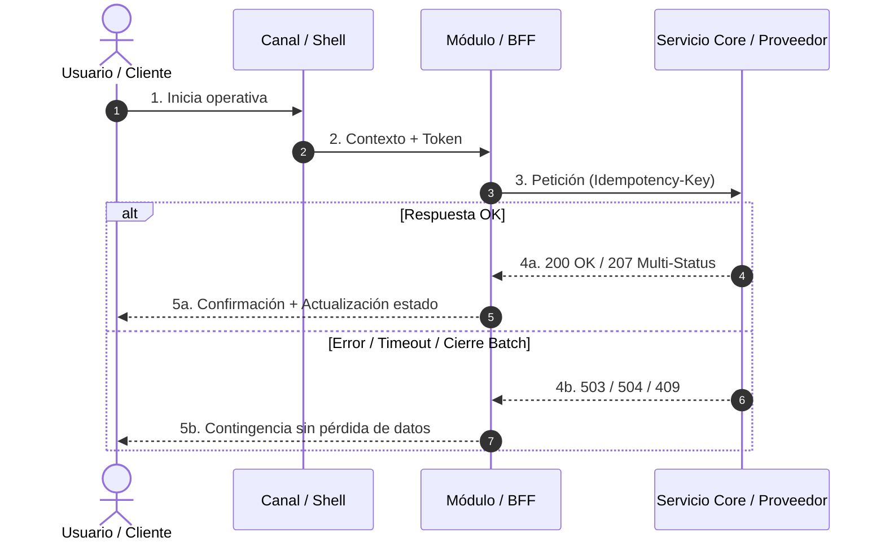

# Archivo de Conocimiento #1 — Plantilla Universal Modular para Confluence (Sin HTML)

> **Instrucción para el Agente:** Usa este documento como esqueleto maestro. Incluye **siempre** el **Núcleo Universal** y ensambla únicamente los **Módulos Especialistas (A–E)** que apliquen a la iniciativa detectada en el Microsoft Graph del usuario. Reemplaza todos los `<placeholders>` con información verificada de las fuentes; si un dato falta, inserta un bloque `> ⚠️ **[PENDIENTE DEFINIR CON <Rol/Nombre>]:**`.

---

## NÚCLEO UNIVERSAL (Obligatorio en cualquier iniciativa)

# [<CODIGO-INICIATIVA>] <Nombre Funcional del Proyecto o Épica>

| Atributo | Especificación del Proyecto |
| :--- | :--- |
| **Estado de Definición** | `🟡 EN REFINAMIENTO` *(<X> % cerrado — Pendientes: `<RN-XX>`, `<SH-XX>`)* |
| **Arquetipos Activos** | `<UI/Figma>` · `<Integración Shell>` · `<Transaccional/SCA>` · `<Chatbot/IA>` · `<API/Batch>` |
| **Canales y Contenedor** | `<🖥️ Web Shell vX>` · `<📱 App iOS/Android WebView vX>` · `<⚙️ Servicio BFF/Core>` |
| **Diseños en Figma** | • `<Flujo Principal>`: `[Pegar enlace Figma Frame #XX]` *(si aplica)* |
| **Objetivo / KPI Cuantificable** | 1. `<Métrica baseline actual>` $\rightarrow$ `<Métrica objetivo y plazo>` |
| **Fuentes M365 Trazadas** | • Reunión Teams: *<Nombre y Fecha>*<br>• Chat/Correo: *<Canal/Asunto y Fecha>*<br>• Documento/PPT: *<Archivo y Versión>* |

---

### 1. Alcance y Registro de Decisiones (*Scope & Decision Log*)

| `🟢 ENTRA EN FASE ACTUAL (In Scope)` | `🔴 FUERA DE ALCANCE (Out of Scope) y Motivo` |
| :--- | :--- |
| • `<Capacidad 1 confirmada>`<br>• `<Capacidad 2 confirmada>` | • **`<Funcionalidad descartada>`:** `<Motivo técnico, de negocio o regulatorio y fecha de reunión donde se acordó>`. |

| Fecha | Cambio de Criterio (Antes $\rightarrow$ Ahora) | Decisor / Fuente M365 |
| :--- | :--- | :--- |
| `<DD/MM>` | `<Qué decía el PPT/documento inicial>` $\rightarrow$ `<Qué se cerró finalmente>` | `<Nombre / Reunión>` |

---

### 2. Reglas de Negocio y Seguridad (`RN-01`, `RN-02`...)

| ID | Regla | Lógica Funcional y Condición Exacta | Excepción / Caso Borde | Estado |
| :--- | :--- | :--- | :--- | :--- |
| **RN-01** | `<Nombre corto>` | `<Condición booleana, umbral numérico o flujo>` | `<Qué pasa si se incumple o caso extremo>` | `🟢 Cerrado` |
| **RN-02** | `<Nombre corto>` | `<Condición>` | `<Excepción>` | `🔴 PENDIENTE` |

---

### 3. Diagrama de Flujo / Secuencia (Mermaid listo para Draw.io)

*(Confluence: Macro Draw.io $\rightarrow$ Organizar $\rightarrow$ Insertar $\rightarrow$ Avanzado $\rightarrow$ Mermaid)*



---

### 4. Criterios de Aceptación Adaptativos (QA & Desarrollo)

*(Elegir la tabla adecuada al caso: Gherkin para flujos de usuario, Contrato para integraciones o Pass/Fail para reglas/IA).*

| ID | Escenario / Prueba | Dado / Precondición | Cuando / Input | Entonces / Resultado Exigido (Pass/Fail) |
| :--- | :--- | :--- | :--- | :--- |
| **CA-01** | `<Camino feliz principal>` | `<Estado inicial>` | `<Acción>` | `<Resultado en UI + Backend + Evento>` |
| **CA-02** | `<Idempotencia / Corte de red>` | `<Operación enviada sin respuesta>` | `<Reintento con mismo Idempotency-Key>` | `<No duplica operación; devuelve estado real>` |
| **CA-03** | `<Error parcial o Contingencia>` | `<Servicio degradado o fallo en 1 de N>` | `<Ejecución>` | `<Aviso exacto al usuario sin perder formulario>` |

---

### 5. Bloque Consolidado de Dudas Abiertas y Dependencias

> ⚠️ **[PENDIENTE DEFINIR CON `<Nombre / Área>` — Límite: `<Fecha>`]:**
> `<Descripción precisa de la decisión abierta y qué parte del Sprint bloquea si no se resuelve>`.

---

## MÓDULOS ESPECIALISTAS (Activar solo si el contexto del Grafo los requiere)

### [MÓDULO A] Comportamiento sobre Figma y Matriz de los 5 Estados Invisibles *(Si hay UI Web/App)*

| Pantalla / Componente | Origen del Dato (Campo API) | Regla de Formato y Truncado (Web vs. App `375px`) |
| :--- | :--- | :--- |
| `<Elemento UI>` | `<servicio.campo>` | `<Máx. caracteres, 1 línea App con ..., Tooltip hover Web>` |

| Estado Invisible | Condición de Disparo | Comportamiento Visual y Técnico | Literal Exacto en Pantalla (`Microcopy`) |
| :--- | :--- | :--- | :--- |
| **1. Vacío (*Empty*)** | `0` registros o sin selección | `<Ocultación de acciones masivas + CTA>` | *"<Título y subtítulo exacto>"* |
| **2. Carga y Doble Clic** | Latencia $> 400\text{ ms}$ / Submit | `<Skeleton N filas + botón disabled + Idempotency-Key>` | *"<Texto estado procesando>"* |
| **3. Límites / Overflow** | $> N$ elementos o $> X$ chars | `<Paginación, bloqueo de selector o truncado>` | *"<Toast límite>"* |
| **4. Error / Timeout** | `HTTP 5xx` / Timeout $> X\text{ s}$ | `<Preservar datos del formulario + Banner inline/Modal>` | *"<Mensaje humano accionable>"* |
| **5. Permisos / Bloqueos** | Rol insuficiente / Estado caducado | `<Ocultar vs. disabled + icono candado + Tooltip>` | *"<Motivo de bloqueo>"* |

---

### [MÓDULO B] Integración con Shell y Concurrencia Multicanal *(Si vive dentro del Shell Web/App)*

```text
+-------------------------------------------------------------------------+
| SHELL CONTENEDOR (Header Web / Native Wrapper iOS-Android)              |
| [ <- Atrás ]                                  [ 🔔 Contador ] [ Perfil ]|
+-------------------------------------------------------------------------+
       | (1) shell:context_init                ^ (2) module:badge_sync
       v                                       | (3) shell:intercept_back
+-------------------------------------------------------------------------+
| MÓDULO EMBEBIDO (Microfrontend / WebView)                               |
| <Flujo funcional principal sin duplicar cabecera del Shell>             |
+-------------------------------------------------------------------------+
```

| ID | Evento / Escenario | Dirección | Payload / Código | Comportamiento y Fallback |
| :--- | :--- | :--- | :--- | :--- |
| **SH-01** | `shell:context_init` | Shell $\rightarrow$ Módulo | `{ jwt, userId, lang, platform, biometricAvailable, deepLink }` | `<Gestión de idioma, biometría y Silent Refresh si caduca JWT>` |
| **SH-02** | `module:badge_sync` | Módulo $\rightarrow$ Shell | `{ counterId, count }` | `<Actualiza contador superior en <300ms sin recargar>` |
| **SH-03** | `shell:intercept_back` | Módulo $\leftrightarrow$ Shell | `{ lock: true, reason }` | `<Bloquea Atrás en navegador/Android y swipe back iOS en paso crítico>` |
| **SH-04** | Concurrencia Web/App | Backend $\rightarrow$ Módulo | `HTTP 409 Conflict` | `<Si se ejecutó en otro canal 5s antes, refresca y avisa sin error rojo>` |

---

### [MÓDULO C] Operativa Transaccional, SCA (PSD2) y Custodia Legal *(Si hay pagos, firmas o autorizaciones)*

| Aspecto Crítico | Especificación Obligatoria |
| :--- | :--- |
| **Reto SCA y Fallback** | App: `<Biometría nativa/FIDO2>` $\rightarrow$ Fallback tras 2 fallos a `<OTP SMS/Push>`. Web: `<OTP/Push>`. |
| **Límites y Bloqueo Fuerza Bruta** | TTL: `<180s>`. Máx. intentos: `<3>`. Bloqueo: `<15 min>` (`OTP_BRUTEFORCE_LOCK`) sin bloquear lectura global. |
| **Lotes y Fallo Parcial (`HTTP 207`)** | Máx. `<N>` ítems. Sin rollback de los exitosos; modal ASCII separando `🟢 Completados` y `🔴 Reintentables`. |
| **Pista de Auditoría (`Audit Trail`)** | Persistir inmutable (`<10 años>`): `audit_event_id`, `document_sha256` / `payload_hash`, `user_id`, `sca_method`, `timestamp_utc`, `ip_origen`, `idempotency_key`. |

---

### [MÓDULO D] Gobierno Conversacional IA (EU AI Act, Guardrails & PII) *(Si hay Chatbot / Agente)*

| Vector de Gobierno | Regla Aplicada |
| :--- | :--- |
| **Acotación / Cero Alucinación** | Responder solo desde `<Fuentes/APIs autorizadas>`. Si el dato no existe: *"Ese dato no aparece especificado..."* |
| **Guardrails Regulatorios** | Prohibido emitir recomendaciones financieras, fiscales o legales. Ante intento o *Prompt Injection*: bloqueo neutro + `[Contactar con gestor]`. |
| **Enmascaramiento PII Pre-LLM** | Redaction en BFF antes del proveedor LLM: `IBAN`, `PAN`, `DNI/NIE`, teléfonos $\rightarrow$ `<TOKEN_PII>`. |
| **Aislamiento y Retención** | Timeout `<8s>`. Fallo LLM nunca bloquea la operativa transaccional. Retención de historial según validación DPO. |

---

### [MÓDULO E] APIs, Ventanas Batch y Matriz de Resiliencia / Kill Switch *(Si hay lógica Core/Servicios)*

| Componente / Servicio | Feature Flag (Kill Switch) | Comportamiento Normal | Modo Degradado ante Caída o Ventana Batch |
| :--- | :--- | :--- | :--- |
| `<Servicio Satélite / IA>` | `ff_<feature>_enabled` | `<Operativa completa>` | `<Ocultación remota sin pasar por App Store; operativa core intacta>` |
| `<Core Bancario / Host>` | `HTTP 503 CORE_MAINTENANCE` | `<Ejecución síncrona>` | `<Modo solo lectura o encolado con aviso de ventana horaria>` |
