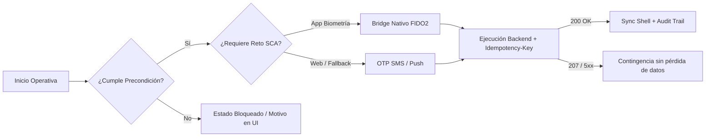

# Archivo de Conocimiento #2 — Catálogo UX sin HTML, Patrones ASCII y Mermaid

> **Instrucción para el Agente:** Confluence convierte Markdown estándar al pegar. Nunca uses etiquetas HTML complejas (`<div>`, `<style>`, `<table>`). Utiliza exclusivamente los patrones de este catálogo para que la página sea visualmente impecable, escaneable y lista para ingeniería.

---

## 1. Semáforos y Etiquetas Visuales Unicode (Sobriedad Bancaria)

Usa estos marcadores consistentes dentro de tablas y títulos:
- **Estado de definición:** `🟢 Cerrado` | `🟡 En refinamiento` | `🔴 Pendiente` | `🔒 Bloqueado`
- **Canales:** `🖥️ Web` | `📱 App iOS/Android` | `⚙️ BFF / Core`
- **Alertas en cita (`>`):**
  - `> ⚠️ **[PENDIENTE DEFINIR CON <Responsable/Área>]:** ...` (Falta definición de negocio/UX/legal)
  - `> ⚡ **[RESTRICCIÓN TÉCNICA / ARQUITECTURA]:** ...` (Timeout, límite Core, WebView)
  - `> 🔒 **[COMPLIANCE / SEGURIDAD / DPO]:** ...` (SCA, PII, custodia, EU AI Act)

---

## 2. Guía de los 5 Estados Invisibles sobre Figma (Qué documentar siempre)

Cuando el diseño visual ya está en **Figma**, no pierdas líneas describiendo colores o márgenes. Documenta obligatoriamente estos 5 estados dinámicos:

1. **Estado Vacío (*Empty State*):** Primer acceso o búsqueda con 0 resultados. Indica si se ocultan barras de acción masiva y qué botón CTA alternativo aparece.
2. **Estado de Carga y Latencia (> 400 ms):** Número de filas *skeleton*, deshabilitación inmediata del botón tras el primer clic/tap para evitar duplicados, y generación de `Idempotency-Key`.
3. **Desbordamiento y Límites Responsive (`375px` App vs. Web):** Longitud máxima de textos, reglas de truncado (`1 línea + ...` en móvil vs. `2 líneas + Tooltip hover` en Web), paginación o límite máximo de elementos seleccionables.
4. **Errores y Contingencia sin Pérdida de Datos:** Qué errores muestran *banner inline*, cuáles *toast* temporal y cuáles *modal*. **Regla de oro:** ante `500/504`, jamás borrar lo que el usuario ya rellenó o adjuntó.
5. **Permisos, Roles y Estados Terminales:** Cuándo un botón se **oculta** (el usuario nunca puede hacer eso por perfil/canal) vs. cuándo se muestra **deshabilitado (`disabled`) con explicación** (tiene acceso, pero falta lectura previa, venció el plazo o falta poder suficiente).

---

## 3. Librería de Wireframes Tácticos en ASCII (` ```text `)

Usa bloques monoespaciados **solo para casos que Figma no cubre** (contingencias de error parcial, contratos Shell y flujos conversacionales).

### Patrón 3.1 — Modal de Contingencia / Fallo Parcial (Sin Rollback)
```text
+-----------------------------------------------------------------------+
|  ⚠️ <Operación> completada parcialmente                         [ X ] |
+-----------------------------------------------------------------------+
|  Resultado del procesamiento en lote:                                 |
|                                                                       |
|  🟢 [Completado] <Elemento #1>                     (Ref: #<ID-A>)     |
|  🟢 [Completado] <Elemento #2>                     (Ref: #<ID-B>)     |
|  🔴 [Error]      <Elemento #3>                     (<Motivo breve>)   |
|      └─ Permanece disponible para reintento individual.               |
|                                                                       |
|  Los elementos completados no requieren repetir la operación.         |
|                                                                       |
|  [ Volver ]                          [ 🔄 Reintentar pendiente (1) ]  |
+-----------------------------------------------------------------------+
```

### Patrón 3.2 — Flujo Conversacional de Chatbot (Happy Path + Guardrail)
```text
+-----------------------------------------------------------------------+
|  🤖 <Nombre Asistente>                            [ Limpiar ]   [ X ] |
|  ℹ️ Respuestas generadas por IA sobre <Fuente/Documento>.             |
+-----------------------------------------------------------------------+
|  Chips sugeridos: ( <Pregunta 1> ) ( <Pregunta 2> ) ( <Resumen> )     |
|                                                                       |
|                                     +------------------------------+  |
|                                     | <Pregunta factual usuario>   |  |
|                                     +------------------------------+  |
|  +-----------------------------------------------------------------+  |
|  | <Respuesta concisa en máx. 2 párrafos o 3 viñetas con datos>.   |  |
|  | 📌 Fuente verificada: [<Sección / Cláusula / Pág. X>]           |  |
|  +-----------------------------------------------------------------+  |
|                                                                       |
|                                     +------------------------------+  |
|                                     | <Pregunta fuera de alcance / |  |
|                                     |  solicitud consejo o bypass> |  |
|                                     +------------------------------+  |
|  +-----------------------------------------------------------------+  |
|  | 🔒 <Mensaje neutro de límite regulatorio / guardrail sin        |  |
|  | juzgar>. Puedes **[contactar con tu gestor]** para revisarlo.   |  |
|  +-----------------------------------------------------------------+  |
|  [ Escribe tu consulta...                                ] [ Enviar ] |
+-----------------------------------------------------------------------+
```

---

## 4. Plantillas Mermaid para Importar en Draw.io

### Patrón 4.1 — Diagrama de Decisión / Bifurcación (`flowchart LR`)

