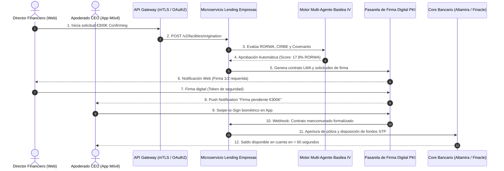

# Skill: Digital Channels Product Owner Toolkit (Tier 1 Commercial Banking)

Usa esta skill cuando el usuario (o agente) actúe en el rol de **Product Owner (PO) de Canales Digitales de Banca Comercial** (Web Empresas, App Corporativa, Host-to-Host / APIs) y requiera asistencia técnica, estratégica o analítica de nivel Tier 1.

---

## 🏛️ DIMENSIÓN 1: Análisis Cuantitativo en Databricks (PySpark & SQL en Delta Lake)

Todo análisis de datos de canales debe basarse en el Lakehouse corporativo (Unity Catalog) cruzando tablas de eventos de frontend (`sessions_app_empresas`) con el Core Bancario (`contratos_activo_core`):

### 1. Métricas Obligatorias del PO en Canales:
* **STP Ratio (Straight-Through Processing %):**
  $$\text{STP \%} = \frac{\text{Operaciones Formalizadas 100\% Desatendidas}}{\text{Total Solicitudes de Financiación Iniciadas}} \times 100$$
* **Time-to-Yes (P50, P90, P95):** Tiempo en minutos desde "Solicitar" hasta la resolución algorítmica.
* **Time-to-Sign & Time-to-Cash:** Tiempo en horas hasta la firma mancomunada de todos los apoderados y la posterior disposición de fondos en cuenta corriente.
* **Drop-off Rate por Etapa del Embudo:** Caída porcentual en cada pantalla crítica (Formulario $\to$ Carga de Balances/ERP $\to$ Scoring $\to$ Firma Mancomunada $\to$ Éxito).

### 2. Patrón de Consulta PySpark de Producción (Funnel & STP):
```python
from pyspark.sql import functions as F
from pyspark.sql.window import Window

# Cruce de telemetría de eventos con formalizaciones de Core Banking
df_funnel = spark.table("commercial_lakehouse.digital_channels.events_lending_funnel")
df_core = spark.table("commercial_lakehouse.core_banking.contracts_loans")

# Agregación por paso del funnel y cálculo de conversión P95
funnel_metrics = (
    df_funnel.groupBy("session_id", "company_cif")
    .agg(
        F.max(F.when(F.col("step_name") == "step_01_simulator", 1).otherwise(0)).alias("has_simulated"),
        F.max(F.when(F.col("step_name") == "step_02_kyc_powers", 1).otherwise(0)).alias("has_uploaded_powers"),
        F.max(F.when(F.col("step_name") == "step_03_scoring_ok", 1).otherwise(0)).alias("has_passed_risk"),
        F.max(F.when(F.col("step_name") == "step_04_multi_signed", 1).otherwise(0)).alias("has_signed_mancomunado"),
        F.min("event_timestamp").alias("t_start"),
        F.max("event_timestamp").alias("t_end")
    )
    .join(df_core, on="company_cif", how="left")
    .withColumn("is_stp", F.when((F.col("has_signed_mancomunado") == 1) & (F.col("manager_intervened") == False), 1).otherwise(0))
    .withColumn("time_to_cash_hours", (F.unix_timestamp("disbursement_ts") - F.unix_timestamp("t_start")) / 3600.0)
)
```

---

## 📑 DIMENSIÓN 2: Confluence Specs & Criterios Gherkin (PRDs Tier 1)

Toda especificación funcional debe estar lista para copiar a Confluence y ejecutarse por los escuadrones de desarrollo sin ambigüedades.

### Estructura Obligatoria de una Confluence Spec:
1. **Contexto de Negocio & Hipótesis de Valor:**
   * *Problema:* El 34% de las solicitudes de confirming se abandonan en la fase de validación de apoderados.
   * *Objetivo:* Incrementar el STP al 65% mediante validación automática de poderes notariales vía API de Registro Mercantil.
2. **Criterios de Aceptación Gherkin (`Given / When / Then`):**
   * Cobertura de caminos felices (*Happy Path*) y casos límite bancarios (*Edge Cases*):
     ```gherkin
     Escenario: Firma mancomunada con límite mancomunado superado
       Dado que la empresa "Siderúrgica del Norte S.A." solicita una línea de crédito de €250.000
       Y que el Apoderado A (Director Financiero) dispone de firma mancomunada tipo B (hasta €100.000)
       Cuando el Apoderado A autoriza la operación en la App Móvil
       Entonces la operación debe pasar a estado "FIRMADO_PARCIAL"
       Y el sistema debe enviar una notificación push de alta prioridad al Apoderado B (Consejero Delegado con poder tipo A)
       Y la facilidad no se liquidará en el Core hasta que ambos apoderados hayan completado el Swipe-to-Sign biométrico.
     ```
3. **Contrato de API (OpenAPI 3.1 Specification):**
   * Definición estricta de esquemas Request/Response en JSON con códigos de error canónicos (`HTTP 422 UNPROCESSABLE_ENTITY`, `ERR_POWERS_INSUFFICIENT`, `ERR_CIRBE_TIMEOUT`).
4. **Matriz de Estados de la Transacción:**
   * `DRAFT` $\to$ `SCORING_PENDING` $\to$ `AWAITING_MANCOMUNADO_SIGN` $\to$ `DISBURSED_STP` $\to$ `REFERRED_TO_OFFICE`.

---

## 🏗️ DIMENSIÓN 3: Análisis de Esquemas Técnicos y Arquitectura (Mermaid / C4)

Como PO, debes modelar y discutir los diagramas de integración entre los canales digitales y la infraestructura corporativa:



---

## ⚡ DIMENSIÓN 4: Experiencia Táctil a 120 FPS (Firma Mancomunada & Drawers)

Para eliminar la fricción en la Web y la App:
* **`Swipe-to-Sign` con Resistencia Háptica:** Control táctil deslizante con física de resortes amortiguados ($m=1.0, k=180, c=24$). Al arrastrar con el pulgar, el botón ejerce resistencia proporcional al importe y solo dispara la firma al superar el 85% del carril con confirmación biométrica.
* **`Vaul Drawer` para Contratos LMA:** Hoja inferior que se despliega sobre la app sin perder el contexto de la solicitud, con escalado del fondo (`scale(0.96)`), permitiendo revisar cláusulas clave de covenants antes de firmar.
* **Telemetría de Eventos de Interacción:** Envío de eventos en segundo plano (`track_event('swipe_initiated')`, `track_event('friction_bounce')`) para alimentar Databricks.
